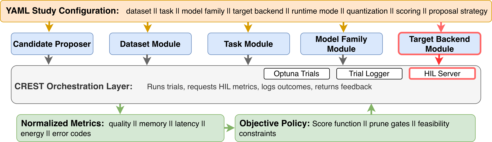

<!--
Copyright (c) 2026 UCLA Networked & Embedded Systems Laboratory
SPDX-License-Identifier: BSD-3-Clause
-->

# CREST: Cross-platform Runtime Evaluation and Search Tool

**A toolkit for hardware-in-the-loop model search on microcontrollers.**

[Quick start](#quick-start) · [Supported workloads and hardware](#supported-workloads-and-hardware) · [Documentation](#documentation) · [Contributing](#contributing)

CREST helps researchers select neural networks for embedded sensing applications
using task quality, deployment constraints, and measurements from real hardware.
It connects model training and candidate search to compilation, programming,
latency and energy measurement, and feasibility checks on the target MCU.

Use CREST to investigate how model selection changes when you change a board,
runtime schedule, objective, or proposal strategy. Workload and model-family
adapters share the same evaluation pipeline with target backends, so supported
experiment variations can be selected through configuration.



## What you can do

- **Search with hardware feedback.** Evaluate candidate memory use, latency, and
  board energy during search, or start with hardware-free FLOPs and memory-traffic
  objectives.
- **Compare execution schedules.** Measure continuous inference or periodic
  releases that include inference and waiting or sleep. Keep measurement validity
  separate from deployment feasibility, using the telemetry each backend provides.
- **Change candidate generators.** Use native Optuna sampling or an optional LLM
  proposer with the same candidate evaluation and scoring path. LLM support
  includes validated proposals, recorded feedback, and resumable local state.
- **Express application tradeoffs.** Configure scalar scores or multiple
  objectives, pruning rules, and constraints on available metrics.
- **Revisit selections.** Replay logged candidate configurations on another
  supported target without repeating the search. Source quality and new hardware
  measurements retain separate provenance.
- **Extend an experiment.** Add dataset, task, model-family, optimizer, or target
  implementations through documented interfaces.

## Supported workloads and hardware

The repository includes two workload/model-family combinations:

| Workload | Dataset | Model family | Starting configuration |
| --- | --- | --- | --- |
| Inertial odometry | OxIOD | Temporal convolutional network (TCN) | [Hardware-free proxy search](src/config/nas_config_flops_rmse.yaml) |
| Audio classification | UrbanSound8K cached log-mel features | Depthwise-separable CNN (DS-CNN) | [STM32 audio search](src/config/nas_config_audio_stm32.yaml) |

Hardware backends support **Arduino Nano 33 BLE Sense**, **Arduino Portenta H7**
(CM7 and CM4 configurations), and **STM32 NUCLEO-N657X0-Q**. Energy measurement
uses a separate harness MCU and an INA228 power monitor. Toolchain setup,
measurement fields, and schedule telemetry differ by backend; see the
[hardware guide](src/crest/microcontrollers/README.md).

The supplied studies measure model execution from recorded inputs or prepared
features. Audio capture and feature extraction are outside the audio example's
measurement boundary. Adding an unfamiliar board requires backend integration;
adding a new application requires compatible workload/model components.

## Quick start

### 1. Install the environment

Use Git, Conda, and Make. The supplied environment selects Python 3.11 and the
project's pinned TensorFlow stack.

```bash
git clone --recurse-submodules https://github.com/nesl/crest.git
cd crest
conda env create -f environment.yml -n crest
conda activate crest
make install
```

CPU execution is sufficient for the first example. For GPU training, follow the
[optional TensorFlow CUDA setup](src/GETTING_STARTED.md#environment-setup).

### 2. Prepare a dataset

For the OxIOD example, obtain the dataset archive using the
[dataset preparation instructions](data/dataset_download_and_splits/README.md),
then run:

```bash
make prepare-dataset OXIOD_ZIP=/path/to/OxIOD.zip
```

For audio, use `make prepare-audio-dataset` after obtaining UrbanSound8K and
following the same dataset guide. Dataset downloads and generated feature caches
are separate from the source repository.

### 3. Run a small hardware-free search

```bash
python src/nas_model_client.py \
  --config src/config/nas_config_flops_rmse.yaml \
  --smoke-test 3 \
  --study-name oxiod_proxy_smoke
```

This performs three smoke-test attempts using the OxIOD TCN workload and the
validation-error/FLOPs objective. It requires the prepared dataset and performs
host-side model evaluation, but does not require a board, vendor toolchain, or
LLM API credentials. The smoke study is saved under
`models/oxiod_proxy_smoke_STM32_NUCLEO_N657X0_Q/`, including its
`optuna_smoke_test.db` trial database. The CLI appends the configured device name
to smoke-study names, even when hardware evaluation is disabled.

For a full search, omit `--smoke-test` and choose a fresh study name. Review
`training.nas_trials`, `training.nas_epochs`, and the objective in the YAML first;
full searches can take substantially longer than the smoke pass.

## Run with hardware

Choose a [Nano 33 BLE](src/config/nas_config_ble.yaml),
[Portenta H7](src/config/nas_config_portenta.yaml), or
[STM32](src/config/nas_config_stm32.yaml) configuration. Complete the board and
harness setup, set the serial ports and data paths, and use matching configuration
settings for the client and HIL server.

For example, after STM32 setup, run the server in one terminal:

```bash
python src/hil_server.py --config src/config/nas_config_stm32.yaml
```

Run the search client in another:

```bash
python src/nas_model_client.py \
  --config src/config/nas_config_stm32.yaml \
  --study-name oxiod_stm32
```

The client and server can share a machine. For a separate GPU training host and
board-connected host, see the [HIL connection guide](src/GETTING_STARTED.md#running-nas-and-hil).

A study's YAML selects the dataset, task, model family, target, runtime schedule,
objectives, and feasibility rules. Native Optuna is the default proposer. To try
LLM proposals, follow the [optimizer guide](src/crest/optimizers/README.md) for
provider credentials, history policies, spending configuration, and resume rules.
Live provider calls may incur charges; offline examples use a fake provider.

## Results and examples

Each study stores its Optuna database, trial logs, and configuration-dependent
model artifacts under the configured output directories. Scalar studies can
retrain and export the selected model; multi-objective studies export Pareto
candidates. LLM studies additionally retain proposal, response, and memory records.
See [output details](src/GETTING_STARTED.md#4-outputs) before interpreting or
sharing those artifacts.

The repository includes examples for:

- [Proxy versus measured-energy selection and runtime-schedule comparisons](src/config/case_study_configs/README.md).
- [LLM proposal configuration](src/crest/optimizers/README.md) and
  [offline optimizer regression tests](test/test_llm_offline_campaign.py).
- [Candidate replay](src/README.md#pareto-hil-replay) and
  [saved-study analysis](analysis_scripts/README.md).

## Documentation

| Guide | Contents |
| --- | --- |
| [Getting started](src/GETTING_STARTED.md) | Dataset preparation, GPU setup, vendor tools, HIL connections, and outputs |
| [Configuration reference](src/config/README.md) | Runtime settings, objectives, constraints, and optimizer options |
| [Source guide](src/README.md) | Architecture, shared contracts, and extension points |
| [Optimizer guide](src/crest/optimizers/README.md) | Proposal interfaces, providers, history, budgets, and resume behavior |
| [Hardware backends](src/crest/microcontrollers/README.md) | Supported boards, toolchains, and backend implementation |
| [Firmware](sketches/README.md) | DUT and measurement-harness firmware |
| [Analysis utilities](analysis_scripts/README.md) | Tools for inspecting saved experiment results |

## Contributing

Bug reports and focused pull requests are welcome through
[GitHub issues](https://github.com/nesl/crest/issues) and
[pull requests](https://github.com/nesl/crest/pulls). Include the configuration,
reproduction steps, software versions, and target board when reporting a problem.
Remove credentials and private experiment content from shared logs.

For extensions, start with the [source guide](src/README.md) and the contributor
instructions for [datasets](src/crest/datasets/README.md),
[tasks](src/crest/tasks/README.md),
[model families](src/crest/model_families/README.md), or
[hardware backends](src/crest/microcontrollers/README.md).

With the environment installed, run the default test suite:

```bash
make test
```

Document Python APIs with NumPy-style docstrings and add focused tests for changed
behavior. Keep generated data, run reports, credentials, and private working notes
out of source contributions; place detailed usage documentation beside the
relevant component.

## License

Repo-owned CREST code, documentation, configuration, and tests are licensed
under the BSD 3-Clause License unless otherwise noted. See [LICENSE](LICENSE)
for the full license text.

Important exceptions and separately governed materials:

- STM32/ST/CMSIS material under
  [`sketches/stm32/crest_stm32_lrun/`](sketches/stm32/crest_stm32_lrun/)
  remains subject to the upstream STMicroelectronics, CMSIS, and related
  license terms documented in that directory.
- STM32 vendor-derived and tool-generated build recipe files in the LRUN
  workspace are not relicensed by CREST headers.
- The Arduino TensorFlow Lite Micro dependency tracked as the
  [`tools/arduino-user/libraries/Arduino_TensorFlowLite`](tools/arduino-user/libraries/Arduino_TensorFlowLite)
  submodule remains governed by its upstream Apache-2.0 license and is not
  relicensed by CREST.
- OxIOD split metadata and upstream OxIOD readme snippets are dataset-related
  materials; raw OxIOD data is downloaded separately and is not stored in this
  repository.
- UrbanSound8K downloaded audio and generated feature caches are governed by
  the UrbanSound8K dataset terms and are not stored in this repository.
