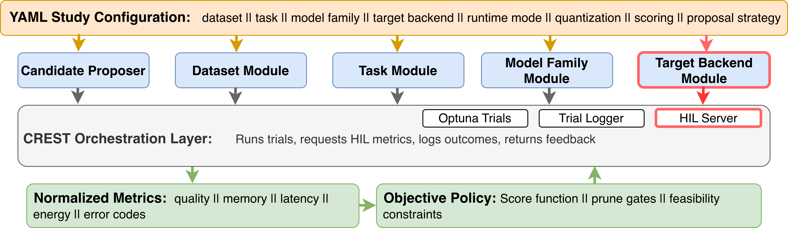

<!--
Copyright (c) 2026 UCLA Networked & Embedded Systems Laboratory
SPDX-License-Identifier: BSD-3-Clause
-->

# CREST Cross-platform Runtime Evaluation and Search Tool



## Summary

CREST is a modular hardware-in-the-loop (HIL) experimentation system for selecting neural networks for embedded sensing.
It lets you vary the selection objective, runtime schedule, target microcontroller, and candidate proposer while reusing the same evaluation and replay workflow.

A model's deployment cost depends on more than inference alone.
In periodic sensing, the board also spends energy waiting or sleeping between releases.
Changing the release period, clock, or target can change which configuration is preferable or whether it meets the application's memory and timing constraints.
CREST measures candidates under the intended deployment conditions so those choices can be checked on hardware.

With CREST, you can do the following.

- **Search using proxy or measured costs.**
  Train, compile, and deploy candidates, then select using task quality, latency, energy, or proxy metrics with scalar or multiple objectives and feasibility constraints.
- **Compare runtime schedules.**
  Continuous execution reports energy per inference.
  Periodic execution reports energy per release, including inference and the following waiting or sleep interval, where supported by the backend.
  Energy is measured at the board supply.
- **Replay selected candidates.**
  Reevaluate candidates on another supported target or under another schedule, keeping source results separate from new measurements.
- **Distinguish measurement validity from deployment feasibility.**
  Records identify the target and measurement interval.
  A candidate can have a valid energy measurement while missing its deadline and being excluded from selection.
- **Extend the experiment.**
  Reuse the evaluator with another workload, model family, hardware backend, or candidate proposer.
  Included examples cover inertial odometry and audio classification, with native Optuna search and optional LLM candidate generation.

## Code architecture

| Location | Contents |
| --- | --- |
| [`src/`](src/README.md) | Search client, HIL server, and shared evaluation pipeline |
| [`src/crest/`](src/crest/README.md) | Dataset, task, model-family, optimizer, and hardware components |
| [`src/config/`](src/config/README.md) | Experiment configurations and settings reference |
| [`sketches/`](sketches/README.md) | Target-device and power-measurement harness firmware |
| [`data/`](data/dataset_download_and_splits/README.md) | Dataset preparation and split definitions |
| [`analysis_scripts/`](analysis_scripts/README.md) | Analysis and plotting of saved experiment results |
| [`test/`](test/) | Automated tests |

The [source guide](src/README.md) describes the component interfaces and how to extend CREST to another workload, model family, optimizer, or hardware backend.

## Requirements

- Git, Conda, and Make.
  The supplied environment installs Python 3.11 and the project's Python dependencies.
- A local OxIOD dataset for odometry or UrbanSound8K dataset for audio classification.
- For hardware evaluation, a supported target board and its build/programming tools.
  Energy measurements also need the CREST harness and INA228 monitor.
- A GPU is optional.
  The hardware-free example below can run on a CPU.
- Provider credentials are needed only for live LLM candidate generation.

## Getting started

```bash
git clone --recurse-submodules https://github.com/nesl/crest.git
cd crest
conda env create -f environment.yml -n crest
conda activate crest
make install
```

Obtain OxIOD using the [dataset instructions](data/dataset_download_and_splits/README.md), then prepare it and run three hardware-free search attempts.

```bash
make prepare-dataset OXIOD_ZIP=/path/to/OxIOD.zip

python src/nas_model_client.py \
  --config src/config/nas_config_flops_rmse.yaml \
  --smoke-test 3 \
  --study-name oxiod_proxy_smoke
```

This example evaluates TCN models using validation error and FLOPs.
It requires the prepared dataset but no board or LLM credentials.
See the [getting-started guide](src/GETTING_STARTED.md) for GPU setup, full searches, hardware connections, and saved outputs.

## Supported workloads and hardware

| Workload | Dataset | Model family | Example configuration |
| --- | --- | --- | --- |
| Inertial odometry | OxIOD | Temporal convolutional network (TCN) | [Proxy search](src/config/nas_config_flops_rmse.yaml) |
| Audio classification | UrbanSound8K log-mel features | Depthwise-separable CNN (DS-CNN) | [STM32 audio search](src/config/nas_config_audio_stm32.yaml) |

Hardware backends support **Arduino Nano 33 BLE Sense**, **Arduino Portenta H7** (CM7 and CM4), and **STM32 NUCLEO-N657X0-Q**.
Energy measurements use a separate harness MCU and an INA228 power monitor.
Follow the [hardware guide](src/crest/microcontrollers/README.md) for board and toolchain setup.

## Documentation and examples

- [Experiment configuration](src/config/README.md).
  Objectives, runtime schedules, constraints, and search settings.
- [Case studies](src/config/case_study_configs/README.md).
  Proxy versus measured energy selection and runtime-schedule comparisons.
- [Optimizers](src/crest/optimizers/README.md).
  Native and LLM candidate generation, provider setup, and extension instructions.
- [Candidate replay](src/README.md#pareto-hil-replay) and [offline analysis](analysis_scripts/README.md).
  Evaluate and inspect saved experiments.

## Contributing

Questions, bug reports, and focused contributions are welcome through [GitHub issues](https://github.com/nesl/crest/issues) and [pull requests](https://github.com/nesl/crest/pulls).
For a bug report, include the configuration, reproduction steps, software versions, and target board.

Component guides linked from the [source guide](src/README.md) include extension steps and completion checklists.
Run `make test` in the installed environment before submitting code changes.

## License

Repo-owned CREST code, documentation, configuration, and tests are licensed under the BSD 3-Clause License unless otherwise noted.
See [LICENSE](LICENSE) for the full license text.

Important exceptions and separately governed materials

- STM32/ST/CMSIS material under [`sketches/stm32/crest_stm32_lrun/`](sketches/stm32/crest_stm32_lrun/) remains subject to the upstream STMicroelectronics, CMSIS, and related license terms documented in that directory.
- STM32 vendor-derived and tool-generated build recipe files in the LRUN workspace are not relicensed by CREST headers.
- The Arduino TensorFlow Lite Micro dependency tracked as the [`tools/arduino-user/libraries/Arduino_TensorFlowLite`](tools/arduino-user/libraries/Arduino_TensorFlowLite) submodule remains governed by its upstream Apache-2.0 license and is not relicensed by CREST.
- OxIOD split metadata and upstream OxIOD readme snippets are dataset-related materials.
  Raw OxIOD data is downloaded separately and is not stored in this repository.
- UrbanSound8K downloaded audio and generated feature caches are governed by the UrbanSound8K dataset terms and are not stored in this repository.
