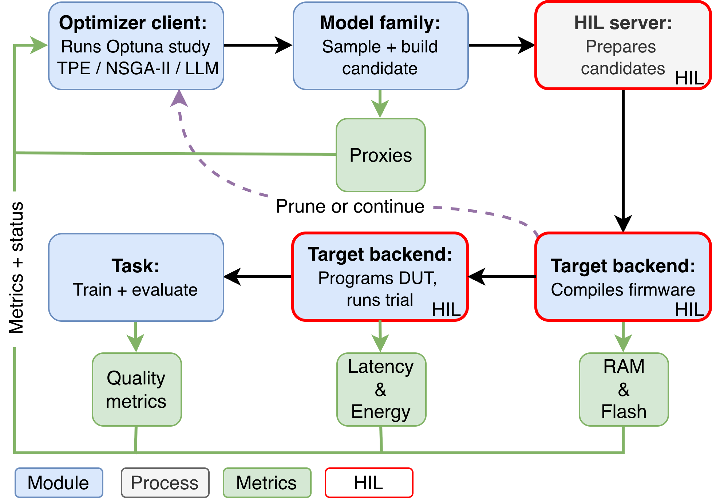

---
hide:
  - navigation
  - toc
---

  <section class="crest-hero" aria-labelledby="crest-home-title">
    

      <h1 id="crest-home-title">Inside a CREST trial</h1>
      
Follow a candidate from the optimizer to the target board and back. CREST brings task quality, memory, latency, and energy into the decision to prune a trial or continue the search.

      

        <a class="crest-button" href="run/first-study/">Run your first study</a>
        <a class="crest-text-link" href="concepts/">How CREST works</a>
      

    

    <figure class="trial-figure">
      

      

      <figcaption>Select a box to explore the docs. <a href="images/crest-trial-flow.png">View full-size diagram</a></figcaption>
    </figure>
  </section>

  <section class="crest-pathways" aria-labelledby="crest-pathways-title">
    <h2 id="crest-pathways-title">Explore the documentation</h2>
    

      <a href="run/" class="crest-card">
        <h3>Run studies</h3>
        
Set up a study, connect a target board, and inspect or replay the results.

      </a>
      <a href="extend/" class="crest-card">
        <h3>Extend CREST</h3>
        
Add a model family or adapt the framework to another workload or target.

      </a>
      <a href="api/" class="crest-card">
        <h3>API reference</h3>
        
Look up the Python interfaces for datasets, tasks, models, and boards.

      </a>
    

  </section>

## Built-in example workloads and targets

<!-- include: README.md#Supported workloads and hardware -->
